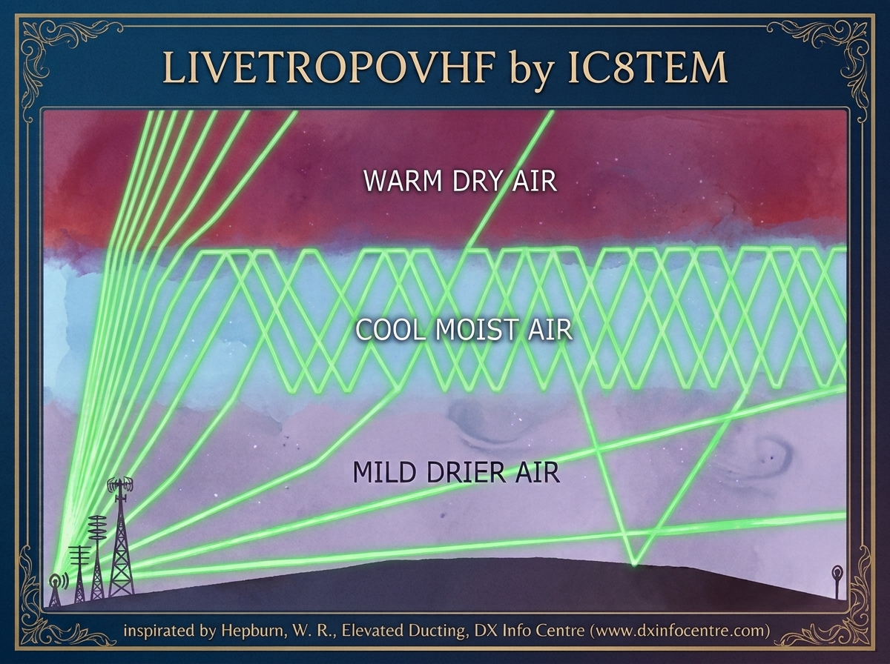

# LIVETROPOVHF

**Live VHF/UHF tropospheric propagation for radio amateurs — by IC8TEM**
*Propagazione troposferica VHF/UHF in tempo reale per radioamatori*

LIVETROPOVHF puts on one map the tropo forecast and what is really happening on the air from 144 MHz up.

  

## What it does / Che cosa fa
- **Forecast** – Hepburn and F5LEN tropo maps, merged worldwide; isobars, 850 hPa isotherms and thermal inversion (Open-Meteo).
- **Live** – spots from DX clusters (ON0DXK, 9A0DXC, S50CLX), RBN and DM4X, PSKReporter (MQTT), your own WSJT-X / JTDX / MSHV decodes (UDP), QSOs inferred from RR73/73.
- **Clean data** – only 144 MHz and up (GRAVES 143.050 kept); meteor scatter, EME, QO-100 and fake listeners filtered out; paths over 1000 km held until confirmed.
- **Locators** – always 6 characters: CALL3.TXT, manual entries, layered files, automatic corrections from DM4X/RBN, MMMonVHF updates and G7VRD as last source.
- **Tabs** – Map, Hepburn, F5LEN, GRAVES, Suspicious reports (self-learning), Data collection, three technical manuals with sources.
- **Portable** – everything next to the program (LIVETROPOVHF.ini, LIVETROPOVHF.db, Dati\\): no registry, no AppData. Interface in 37 languages, 18 colour themes.

## Download / Scarica
Get the latest version from **[Releases](../../releases/latest)**:
- **Windows 10/11**: `LIVETROPOVHF-…-windows-x64-setup.exe` (installs in `C:\LIVETROPOVHF`, no admin rights) or the portable zip; x86 and ARM64 builds too.
- **Windows 7 SP1 / 8.1**: `LIVETROPOVHF-…-windows7-x64-setup.exe` (or x86, or the portable zip), built on .NET 6.
- **Linux**: `.deb`, `.rpm`, Arch `.pkg.tar.zst`, Slackware `.txz`, `AppImage`, `tar.gz`; **Raspberry Pi** 64/32 bit; **Alpine**.
- **Mac**: `.dmg` for Apple Silicon or Intel.

To build from source on Windows: double-click `build-win64.bat` (it installs the .NET 10 SDK locally if missing).

## Windows 7 SP1 / 8.1
The standard Windows build uses .NET 10, which calls `GetSystemTimePreciseAsFileTime` (KERNEL32.dll) at start-up: that function exists only from Windows 8, so on Windows 7 version 1.0.0 stopped with *"Impossibile trovare il punto di ingresso GetSystemTimePreciseAsFileTime…"*.
- From 1.0.1 there are separate **`-windows7-x64`** and **`-windows7-x86`** packages (setup or portable zip), built on .NET 6, the last .NET that runs on Windows 7.
- If you installed 1.0.0 on Windows 7, download the `windows7` setup manually and install it over the old one (1.0.0 cannot start, so it cannot update itself). Settings and data are kept. From then on, automatic updates use the `windows7` packages.
- Only the OCR reading of map axes is missing (it needs Windows 10); Hepburn and F5LEN regions have factory extents, so in practice nothing changes.
- If it still does not start, install **KB2533623** or the Windows 7 SP1 **Convenience Rollup**. Details: [Wiki – Windows 7 e 8.1](../../wiki/Windows-7-e-8.1).

## Automatic updates
Every 30 minutes the program checks the latest Release and, if newer, downloads the portable package for its platform and replaces its own files silently; the new version starts at the next launch. Settings, archive, `Dati\` and `CALL3.TXT` are never touched.

## Documentation
- [Wiki](../../wiki) – quick start, discard criteria, map colours.
- [CHANGELOG.md](CHANGELOG.md) – version history.
- In the program: tabs *Funzionamento*, *Costruzione della mappa*, *Come si forma la tropo* (Italian, exportable to Word).

## Credits
Tropo maps: W. R. Hepburn (DX Info Centre), F5LEN. Weather: Open-Meteo. Coastlines: Natural Earth. Spots: DX clusters, Reverse Beacon Network, DM4X, PSKReporter. Callsign database: CALL3.TXT / MMMonVHF, G7VRD locator API. GRAVES data: PE1ITR and the YA-MS project.

---
*Software for amateur radio use. Forecasts are indications, not guarantees.*
